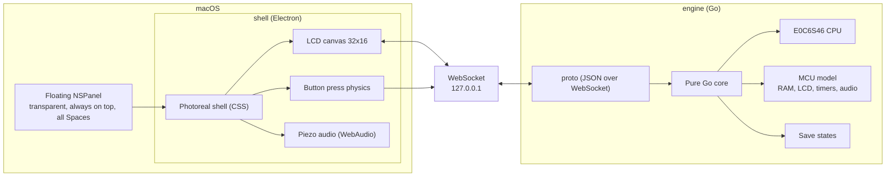

# Architecture

## The shape of it



## Why two processes

The engine holds everything that is worth testing: the processor emulation, the
memory map, the timer model, the pet state, the save file. It has no
dependency on a window, a renderer or a display. It runs headless on a build
machine and in CI.

The shell holds everything that is worth throwing away and rewriting: the
plastic, the pixel grid, the button physics, the audio. None of it has
meaning without the engine's output. The printed shell designs are CSS
variables on one element, so adding a design is a block of colour values and
an SVG tile, not a new screen. Two noise fields over the plastic give it the
mottle and tooth of moulded ABS, and a diagonal reflection and rim light keep
it from reading as a flat silhouette. The design name travels to the renderer
over IPC and is saved next to the window position, so the pet comes back
wearing the same shell.

The split is what makes the engine portable. The same Go package that drives
the desktop build compiles to WebAssembly for a browser version and to TinyGo
for an ESP32 with a small OLED. Neither target needs the shell.

The shell starts the engine as a child process and stops it on the way out.
Two processes, one thing to launch. Running the shell without the engine is
an empty screen with no explanation, which is indistinguishable from a broken
pet, so that combination is not offered to anyone.

## The protocol

JSON over a WebSocket bound to 127.0.0.1. Text, not binary, because the
traffic is tiny and a human should be able to read it in a terminal.

Engine to shell:

```json
{"t": "frame", "rows": [12, 34, 56], "icons": 3, "sel": 1}
{"t": "audio", "freq": 4200, "dur": 90}
{"t": "hello", "version": 1}
{"t": "clock", "epoch": 1790000000}
```

Shell to engine:

```json
{"t": "btn", "a": true, "b": false, "c": false}
{"t": "clock", "epoch": 1790000000}
{"t": "save"}
{"t": "load"}
```

`rows` is 16 integers, one bitmask per row of the 32 by 16 screen. `icons` is
a bitmask over the eight status icons. `sel` marks the menu icon that the pet
has highlighted, so the shell can draw the marker on the glass. Nothing on
the wire says what the marker should look like; that belongs to the shell.

Zero-valued fields are omitted, so a missing `icons` or `sel` means zero.

Frames are sent only when the screen, the icons or the selection change. An
idle pet costs almost nothing. That leaves one gap: a shell that connects
while the screen is idle would see nothing at all, so the engine sends a
snapshot of the current frame to every connection as it opens.

## Buttons

The shell reports the whole state of all three buttons, not a list of events.
The engine turns that into presses.

It keeps a latch on the presses that arrived since the last frame, because a
tap can start and finish between two frames. Without the latch a quick tap is
invisible. A button that went down and came back up is presented to the pet as
still down for one frame, and released on the next.

The pet acts on the press, not the release. It also has one combination, A
with C, which mutes the sound. That is why a press of A on the main screen
waits 120 milliseconds: it is checking whether C is joining it. If A comes
back up first, the press is delivered then instead of waiting out the window.

## The clock

The shell tells the engine what time it is when it connects and every thirty
seconds after that. The engine keeps its own offset from the wall clock.

The device has a clock screen, reached by pressing B with no menu icon
selected. Holding A and pressing C there enters the time set mode: A moves the
hours, B moves the minutes, C confirms. That offset belongs to the pet, not to
the engine, because it is part of what the pet is showing.

## Timing

The real P1 runs its processor at 32,768 Hz. The emulator models that clock
rather than free running, because the pet's behaviour depends on it. The
original library exposes the clock through the HAL as a pair of functions,
`sleep_until` and `get_timestamp`, with a stated accuracy of about 30
microseconds.

That pair is also how the emulator gets tested. The test harness swaps in a
virtual clock, so a run is reproducible instead of dependent on how fast the
machine happens to be. The golden trace is that reproducible run.

## Rendering the LCD

The screen is 32 by 16 logical pixels. The shell draws them on a canvas at an
integer scale with a one pixel gap between cells, because the gaps are what
make it read as a real segment display rather than a sprite. Underneath sits
an olive STN backlight and a diagonal glass reflection.

Audio frequency arrives in Hz. The original library works in decahertz, which
is an easy factor of ten to get wrong.

## Decisions

Recorded in [adr/](adr/).

| Number | Decision |
|---|---|
| [0001](adr/0001-split-engine-and-shell.md) | Split the engine from the shell |
| [0002](adr/0002-emulate-the-original-rom.md) | Emulate the original ROM rather than imitate the pet |
| [0003](adr/0003-port-the-cpu-to-go.md) | Port the processor core to Go rather than linking the C library |
